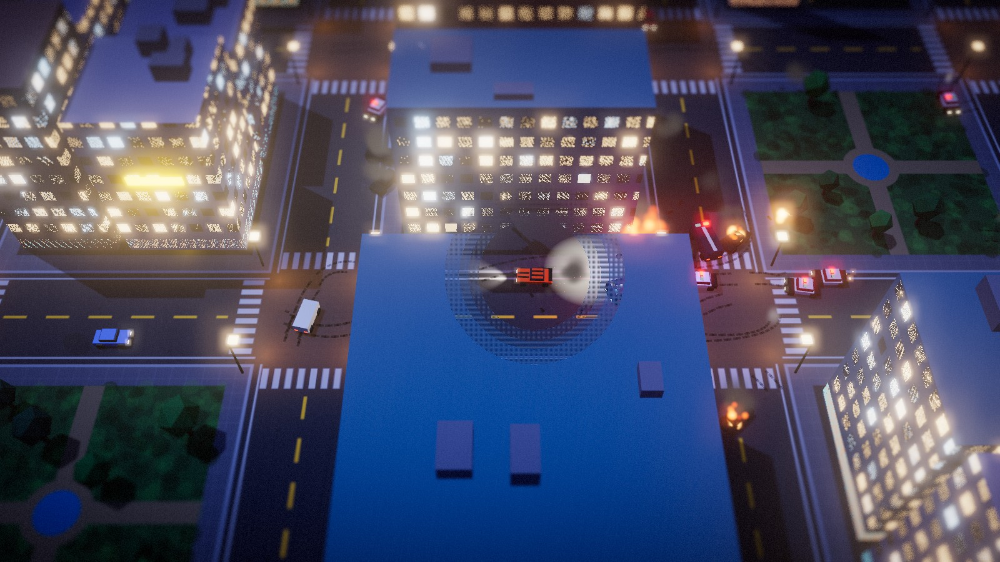
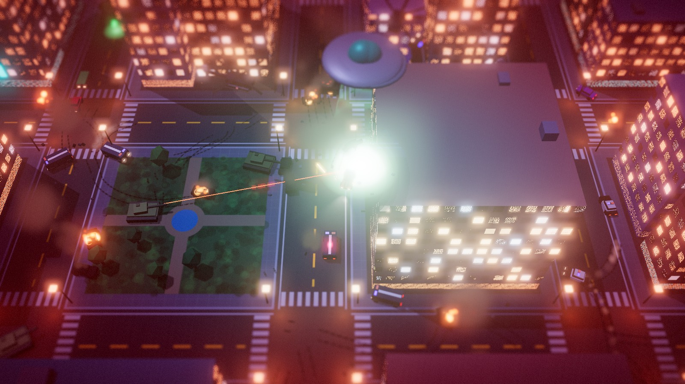

# WANTED ∞

> **수배 레벨에 상한은 없다.**
> 훔친 차로 최대한 오래 버텨라. 별이 늘어날수록 쫓아오는 건… 점점 경찰이 아니게 된다.

**▶ 바로 플레이: https://jeiel85.github.io/wanted-infinity/**

설치할 것 없이 링크 하나로 PC와 모바일 브라우저에서 바로 돌아가는 무한 추격 아케이드 게임입니다.
HTML 파일 하나에 Three.js만 CDN으로 불러오고, 3D 모델·텍스처·효과음·음악은 전부 코드로 만듭니다. 외부 에셋 파일은 하나도 없습니다.




## 어떤 게임인가

오픈월드 범죄 게임에서 가장 재밌는 순간인 **경찰 추격전**만 떼어내 끝까지 밀어붙였습니다.
수배 레벨은 시간이 갈수록, 그리고 추격차를 부술수록 오르고 절대 내려가지 않습니다.

| 수배 | 등장하는 것 |
|---|---|
| ★1–2 | 순찰차 |
| ★3 | SWAT 밴 |
| ★4–5 | 경찰 헬기 (5성부터 사격) |
| ★6 | 군 전차 (조준 레이저 뒤 포격) |
| ★8 | 전투기 공습 (붉은 표적 위로 폭격) |
| ★12 | …UFO (트랙터 빔으로 차량 납치) |
| ★16+ | UFO 함대, 그리고 끝없는 확전 |

- 멈춰 있다가 경찰 두 대 이상에게 둘러싸이면 **BUSTED**, 차 내구도가 바닥나면 **WRECKED**로 끝납니다.
- 폭발은 경찰도 가리지 않습니다. 전차 포탄과 공습에 경찰차가 휘말리고, 연쇄 폭발도 일어납니다.
- 판이 끝나면 생존 시간, 최고 수배 레벨, 파괴한 추격차 수, 최고 속도를 담은 **결과 카드**가 나오고, 이미지로 저장하거나 바로 공유할 수 있습니다.
- 수리 키트(초록 빛기둥)와 니트로(파란 빛기둥)가 도시 곳곳에 나타납니다.

## 조작법

| PC | 동작 |
|---|---|
| `W` `S` / `↑` `↓` | 가속 · 브레이크/후진 |
| `A` `D` / `←` `→` | 핸들 |
| `SPACE` | 드리프트 (핸드브레이크) |
| `SHIFT` | 니트로 |
| `P` / `ESC` | 일시정지 |
| `M` | 소리 켜기/끄기 |
| `Enter` / `R` | 결과 화면에서 다시 시작 |

**모바일**: 화면 왼쪽 아무 곳이나 누르고 가고 싶은 **방향**으로 끌면 차가 알아서 그쪽으로 돌아 달립니다. 오른쪽 아래는 `NITRO`, `DRIFT` 버튼입니다.

## 기술 구성

- **렌더링**: Three.js r170. 후처리는 `UnrealBloomPass`와 직접 작성한 셰이더 패스(틸트시프트 블러, 채도, 비네트, 피격 효과)입니다.
- **도시**: 시드를 고정한 절차적 생성이라 모두가 같은 도시에서 달립니다. 건물은 `InstancedMesh`로 그리고, 창문 불빛은 월드 좌표 기반 셰이더로 만듭니다. 플레이어를 가리는 건물은 화면 공간 디더링으로 뚫어 보이게 합니다.
- **도로**: 차선, 횡단보도, 가로등 불빛을 캔버스 한 장에 그려 텍스처로 씁니다.
- **물리**: 물리 엔진 없이 직접 짠 아케이드 주행(그립/드리프트)과 원 두 개로 근사한 차체 충돌입니다. 충돌 지점에 따라 회전이 생겨 스핀과 PIT 기동이 됩니다.
- **AI**: 격자 도로망에서 시야가 트이면 직진하고, 막히면 교차로를 따라 추격합니다. 끼임을 감지하면 후진해서 빠져나옵니다.
- **사운드**: Web Audio API로 엔진음, 사이렌, 헬기 로터, 폭발음과 수배 레벨에 따라 빨라지고 겹겹이 쌓이는 음악을 실시간 합성합니다.
- **성능**: 모바일에서는 그림자·MSAA·텍스처 해상도를 낮추고, 프레임이 떨어지면 렌더 해상도를 자동으로 내립니다.

## 로컬 실행

빌드 과정은 없습니다. ES 모듈을 쓰기 때문에 `file://` 대신 정적 서버로 여세요.

```bash
python -m http.server 5173
```

그다음 http://localhost:5173 을 엽니다. 주소 뒤에 `?debug`를 붙이면 테스트용 전역 객체 `window.__W`(수배 레벨 조작, 헤드리스 시뮬레이션, 성능 측정)가 열립니다.

## 파일 구성

```
index.html   게임 전체 (HTML/CSS/JS 한 파일)
docs/        README 스크린샷과 SNS 공유용 og 이미지
BACKLOG.md   다음에 할 일
```
